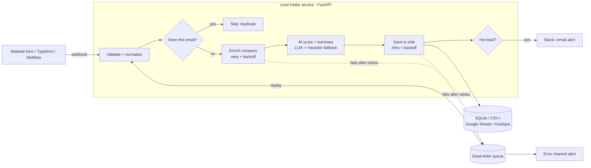

# Lead Intake Automation

**Every inbound lead enriched, AI-scored, saved to your CRM and routed to sales in seconds, with nothing lost when an API goes down.**

  

## The problem

Leads arrive from website forms, Typeform, LinkedIn and ads. Someone copies them into the CRM by hand, looks up the company, guesses whether the lead is worth a call, and pings sales on Slack. It's slow, so hot leads go cold. It's error-prone, so duplicates pile up. And when a no-code zap fails at 2 a.m., the lead just disappears.

## The solution

A small, production-style pipeline that runs every lead through the same steps:

1. **Receive** the lead from any form webhook (FastAPI endpoint or n8n Webhook node)
2. **Validate and dedupe**: emails are normalised, and the same person submitting twice is detected
3. **Enrich**: company name, industry, size and country come from the email domain
4. **AI score and summary**: any OpenAI-compatible model works, with a deterministic rule-based fallback
5. **Save** to SQLite, a CSV file, Google Sheets or HubSpot (pluggable adapters)
6. **Alert** sales on Slack or email when a lead is hot
7. **Recover**: anything that still fails goes to a dead-letter queue that you can replay with one command

It ships in two flavours that share the same Python core:

| Flavour | Best for |
|---|---|
| **Pure Python** (`POST /webhook/lead` or CLI) | Teams that want code they own, version and test |
| **n8n workflow + Python step** (`n8n/lead-intake-workflow.json`) | Teams that like visual workflows but need real code for the hard parts |

## Architecture



**n8n version:** `Webhook → HTTP: /steps/enrich-score (Retry On Fail) → IF duplicate → HTTP: /steps/save → IF hot → Slack → Respond`. Every HTTP node has an **error output** wired to `Record dead letter`, so failed runs are captured with their original payload instead of disappearing into n8n's execution log.

## Features

- **Webhook API** with clear status codes: `201` processed, `200` duplicate, `202` queued in the dead-letter queue, `422` invalid, `401` bad secret
- **Pluggable destinations**: `SINK=sqlite|csv|google_sheets|hubspot`. Google Sheets uses an Apps Script web app (`docs/google-apps-script.js`), so there's no service-account key to manage
- **Any LLM**: OpenAI, Azure, OpenRouter, Groq, or a local Ollama model, all through `OPENAI_BASE_URL`
- **Mock mode by default**: no keys and no network needed. The enrichment fixture, heuristic scorer, local DB and console alerts let you demo it anywhere
- **Importable n8n workflow**, verified end to end on n8n 1.123
- **CLI** for batch imports (`process leads.json`), inspecting the queue (`dlq`) and replaying (`replay <id>`)
- **Docker Compose** for the API, with an optional n8n profile

## Reliability (the part most automations skip)

| Risk | What this project does |
|---|---|
| An API times out or rate-limits (429/5xx) | Exponential backoff with jitter (`RETRY_ATTEMPTS`, `RETRY_BASE_DELAY`). 4xx errors are not retried |
| An API is down for hours | The lead goes to the **dead-letter queue** with its original payload and the failing step, and the error channel is alerted. `replay <id>` re-runs it later |
| Form resubmits or webhook retries | **Idempotency**: emails are normalised (lower-case) and checked against a processed ledger, and sinks upsert on email |
| The LLM returns garbage or is down | Its output is validated, and on any failure the **deterministic heuristic** scores the lead instead, so a lead is never blocked by AI |
| Slack is down after the lead is saved | The lead stays saved, and only the alert goes to the dead-letter queue |
| A bad payload | Validated with Pydantic. It's rejected with a clear `422` and kept in the queue for inspection |
| "What happened to lead X?" | **Structured JSON logs** on every step (email, step, attempt, delay, score, sink ref, duration) |
| Unauthorised posts | Optional `X-Webhook-Secret`, checked with a constant-time compare |

## Quick start (2 minutes, no API keys)

```bash
python -m venv .venv && source .venv/bin/activate
pip install -r requirements-dev.txt
cp .env.example .env

./scripts/demo.sh          # end-to-end demo: 8 sample leads, retries, DLQ, API
pytest                     # 24 tests
```

Run the API:

```bash
uvicorn --factory lead_intake.api:create_app --reload --port 8000
curl -X POST localhost:8000/webhook/lead -H 'content-type: application/json' \
  -d '{"email":"sarah@northwind-logistics.com","name":"Sarah Chen","title":"Head of Ops","budget":"$8,000","message":"automate ASAP"}'
```

Open `http://localhost:8000/docs` for interactive API docs.

### With n8n

```bash
docker compose --profile n8n up -d     # API on :8000, n8n on :5678
```

In n8n, go to **Workflows → Import from file**, pick `n8n/lead-intake-workflow.json`, then activate it. Point your form at `http://<host>:5678/webhook/lead-intake`. Set `SLACK_WEBHOOK_URL` for real Slack alerts. Without it, alerts go to the API's `/mock/slack` endpoint, which writes to `data/alerts.log`.

### Going live

Edit `.env` (all options are documented in `.env.example`):

```env
OPENAI_API_KEY=sk-...           # turns on AI scoring
SINK=hubspot                    # or google_sheets / csv
HUBSPOT_TOKEN=pat-...
NOTIFIER=slack
SLACK_WEBHOOK_URL=https://hooks.slack.com/services/...
WEBHOOK_SECRET=long-random-string
```

## Demo output

`./scripts/demo.sh` (full output in [`docs/demo-output.txt`](docs/demo-output.txt)):

```
=== Summary ===
  processed      sarah.chen@northwind-logistics.com score=95 tier=hot
  processed      dr.martin@atlas-dental.fr        score=72 tier=hot
  processed      tom@brightcart.io                score=57 tier=warm
  processed      jake.p@gmail.com                 score=10 tier=cold
  duplicate      sarah.chen@northwind-logistics.com
  processed      ops@flaky-co.com                 score=87 tier=hot     <- succeeded after 2 retries
  dead_lettered  info@down-api.com                enrichment API 503     <- queued, error channel alerted
  invalid        not-an-email                     email: value is not a valid email address
```

The n8n run is in [`docs/n8n-demo-output.txt`](docs/n8n-demo-output.txt).

## Screenshots

> Placeholders. Add these before publishing:
> - `docs/n8n-workflow.png`: the imported workflow in the n8n editor
> - `docs/slack-alert.png`: a hot-lead alert in Slack
> - `docs/api-docs.png`: the FastAPI `/docs` page

## Project structure

```
lead_intake/
  api.py            FastAPI app: webhook, n8n step endpoints, dead-letter queue
  pipeline.py       orchestration: validate -> dedupe -> enrich -> score -> save -> alert
  enrich.py         mock + HTTP enrichers
  scoring.py        LLM scorer + deterministic heuristic fallback
  sinks/            sqlite, csv, google_sheets, hubspot adapters
  notify.py         console (mock), Slack, email
  store.py          idempotency ledger + dead-letter queue (SQLite)
  retry.py          backoff + transient/permanent error classification
  cli.py            batch process / dlq / replay
n8n/lead-intake-workflow.json
samples/            sample leads + company fixture
tests/              pytest suite (24 tests)
```

## Tech

Python 3.10+, FastAPI, Pydantic v2, httpx, SQLite, pytest, n8n, Docker.

---
Built by **Taha Elkarroumy**: reliable business automations with AI, APIs, Python and TypeScript.
